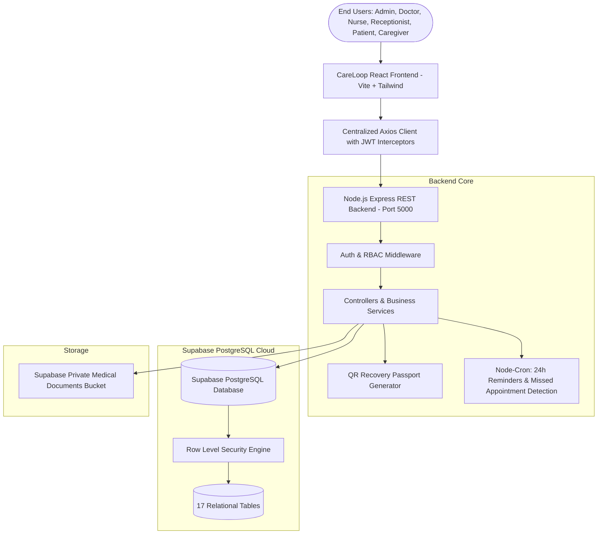

# CareLoop System Architecture & Blueprint

## Security & Verification Layers
1. **Cryptographic Tokens**: Patient Recovery Passports store SHA-256 hashes in PostgreSQL; triage scans query sanitized records without exposing internal database identifiers.
2. **Role-Based Access Control**: Express route-level enforcement backed by Supabase session tokens prevents unauthorized privilege escalation.
3. **Automated Reminders & Missed Appointment Tracking**: Node-Cron jobs periodically detect appointments needing alerts, preventing duplicate notifications.
